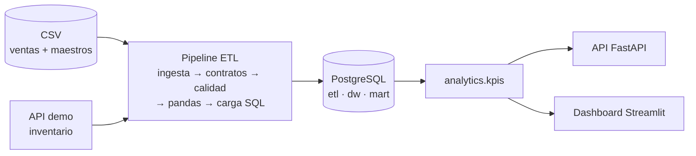

# Retail Data Platform

Plataforma de datos de punta a punta para una cadena de supermercados ficticia
(**Mercado Austral**, 8 tiendas en Chile, montos en CLP). Ingiere ventas desde CSV e
inventario desde una API, valida esquemas y calidad, transforma con **pandas**, carga un
**modelo dimensional en PostgreSQL** de forma **incremental** y expone los KPI comerciales
en una **API FastAPI** y un **dashboard Streamlit**.

[](../../actions/workflows/ci.yml)
· Python 3.12 · pandas 3 · PostgreSQL 17 · SQLAlchemy 2 · FastAPI · Streamlit · Docker Compose

## Qué demuestra

| Área | Implementación |
|---|---|
| Ingesta | CSV diarios (landing zone, sha256) + API REST paginada con token, reintentos con *backoff* exponencial y *jitter*, `Retry-After` |
| Calidad de datos | Contratos declarativos (tipos, nulos, rangos, patrones, reglas entre campos), deduplicación, integridad referencial, *quality gate* por lote, cuarentena de filas en JSONB |
| Transformación | pandas: normalización de códigos y medios de pago, montos bruto/neto, claves de fecha, calendario con feriados de Chile |
| Modelado | Esquema estrella: `dim_date`, `dim_store` (SCD1), `dim_product` (**SCD2**), `fact_sales` (línea de ticket), `fact_inventory_snapshot` (snapshot periódico) + marts agregados |
| Carga | `COPY` a tablas temporales + `INSERT … ON CONFLICT`; un lote = una transacción; idempotente |
| Incremental | Registro de archivos por checksum, *watermark* por fecha para la API, refresco de marts solo para fechas tocadas |
| Operación | Logs JSON con `run_id`, tabla de ejecuciones y lotes, *advisory lock* contra ejecuciones concurrentes, códigos de salida para orquestadores |
| Consumo | API FastAPI documentada (OpenAPI) y dashboard Streamlit con el mismo módulo de KPI |
| Ingeniería | 112 tests pytest (unitarios + integración sobre PostgreSQL real), 97 % de cobertura, ruff, mypy, lockfiles con hashes, Docker *non-root* de solo lectura, CI en GitHub Actions |

## Arquitectura



Diagramas detallados (componentes, secuencia de un lote, modelo entidad-relación) y las
decisiones de diseño (ADR) están en **[docs/architecture.md](docs/architecture.md)**.

## Inicio rápido con Docker

```bash
docker compose up -d --build
python scripts/smoke_test.py          # espera la primera carga y verifica todo el stack
```

| Servicio | URL |
|---|---|
| Dashboard | http://localhost:8501 |
| API de KPI (Swagger) | http://localhost:8000/docs |
| API demo de inventario | http://localhost:8001/docs |
| PostgreSQL | `localhost:5433` (usuario `retail`) |

Compose levanta `db`, `demo-api`, `migrate` y `generate` (de una sola vez), `pipeline`
(se ejecuta cada `PIPELINE_INTERVAL_SECONDS`, 900 por defecto), `api` y `dashboard`. La
primera carga (60 días, ~244 mil líneas de venta, ~30 mil filas de inventario) tarda menos
de un minuto.

**Demostrar la carga incremental:** agrega un día simulado y observa que solo se carga ese
día.

```bash
SIM_DAYS=61 docker compose up -d      # regenera la landing zone y la API demo con un día más
curl "http://localhost:8000/api/v1/pipeline/runs?limit=3"
```

Las credenciales del `docker-compose.yml` son valores de demo para un equipo local; se
pueden cambiar con un `.env` (ver `.env.example`). Para habilitar el disparo del pipeline
por API, define `API_KEY`.

## Desarrollo local (sin Docker)

Requisitos: Python 3.12 y un PostgreSQL accesible.

```bash
python -m venv .venv && source .venv/bin/activate     # Windows: .venv\Scripts\activate
pip install --require-hashes -r requirements-dev.lock && pip install --no-deps -e .
cp .env.example .env                                  # ajusta DATABASE_URL y TEST_DATABASE_URL

retail migrate                                        # crea esquemas etl, dw y mart
retail generate                                       # escribe data/landing/
uvicorn --factory retail_platform.demo_api.app:create_app --port 8001 &
retail run                                            # carga incremental
uvicorn --factory retail_platform.api.app:create_app --port 8000
streamlit run src/retail_platform/dashboard/app.py
```

### CLI

| Comando | Descripción |
|---|---|
| `retail migrate` | Aplica migraciones SQL versionadas (detecta si se editó una ya aplicada) |
| `retail generate [--days N --seed S --dirty-rate R ...]` | Genera la landing zone sintética |
| `retail run [--full-refresh] [--only master sales inventory]` | Ejecuta el pipeline una vez |
| `retail schedule --interval 900` | Ejecuta el pipeline periódicamente |

Códigos de salida de `run`: `0` éxito · `2` parcial (lotes rechazados o fuente caída) ·
`3` otra ejecución en curso · `1` fallo.

## Datos sintéticos reproducibles

`retail generate` simula tickets por tienda, hora y día de la semana (con estacionalidad
semanal, feriados chilenos y tendencia), descuentos promocionales, cambios de precio
mensuales y un inventario con punto de reorden, *lead time* y atrasos de proveedor: las
ventas se limitan al stock disponible, así que los quiebres de stock aparecen solos.

Se inyecta suciedad realista a propósito (`SIM_DIRTY_RATE`, 1 % por defecto):

| Defecto inyectado | Cómo lo trata el pipeline |
|---|---|
| Línea duplicada exacta | Se descarta y se cuenta (advertencia) |
| Cantidad negativa | Cuarentena `range:quantity` |
| SKU inexistente | Cuarentena `unknown_sku` |
| Tienda vacía | Cuarentena `not_null:store_code` |
| Precio `N/A` | Cuarentena `type:unit_price` |
| Fecha imposible | Cuarentena `type:sold_at` |
| `" st001"`, `"DEBITO"`, `"credito "` | Se normaliza, no se rechaza |
| Inventario negativo o sin SKU (API) | Cuarentena `range:on_hand` / `not_null:sku` |

El simulador es determinista por `(semilla, día, tienda)`: aumentar `SIM_DAYS` reproduce
los días anteriores byte a byte, y los totales son idénticos en Windows y Linux.

## KPI

| KPI | Definición |
|---|---|
| Venta neta | Venta bruta − descuentos |
| Margen bruto | Venta neta − costo (costo de la versión del producto vigente en la fecha) |
| Ticket promedio | Venta neta / tickets distintos |
| Unidades por ticket | Unidades / tickets |
| Tasa de descuento · participación promo | Descuentos / venta bruta · venta neta en promoción / venta neta |
| Variación vs periodo anterior | Mismo largo, inmediatamente anterior |
| Quiebre de stock | Posiciones tienda×SKU con 0 unidades / posiciones |
| Días de inventario | Unidades en stock / venta diaria promedio de 28 días |
| Productos en riesgo | Posiciones con menos de 3 días de cobertura |

### Endpoints principales

Todos aceptan `start`, `end`, `store` (repetible) y `category` (repetible); por defecto,
los últimos 30 días con datos.

```
GET  /health
GET  /api/v1/filters
GET  /api/v1/kpis/summary            # KPI + variación vs periodo anterior
GET  /api/v1/kpis/daily-sales
GET  /api/v1/kpis/by-category | by-store | payment-mix
GET  /api/v1/kpis/top-products?limit=10&metric=net_sales|units|gross_margin
GET  /api/v1/kpis/inventory-health | inventory-at-risk
GET  /api/v1/pipeline/runs           # historial de ejecuciones
GET  /api/v1/pipeline/runs/{id}      # detalle por lote
GET  /api/v1/quality/rejections      # filas en cuarentena por regla
POST /api/v1/pipeline/runs           # dispara una ejecución (header X-API-Key) → 202
```

## Pruebas

```bash
pytest                      # unitarias + integración (requiere TEST_DATABASE_URL)
pytest tests/unit           # solo unitarias, sin base de datos
pytest --cov                # cobertura (umbral de CI: 85 %)
ruff check . && ruff format --check . && mypy
```

Las pruebas de integración corren contra PostgreSQL real e incluyen: carga completa
conciliada contra la "verdad" simulada, segunda ejecución sin cambios, día incremental,
archivo re-entregado que reemplaza sus filas, *quality gate*, CSV estructuralmente roto,
API caída a mitad del rango (el watermark no avanza y la siguiente ejecución retoma),
ejecución concurrente bloqueada, error inesperado, `--full-refresh` sin duplicados,
versiones SCD2 sin solapamiento, todos los endpoints de la API, la CLI y el dashboard
(con `streamlit.testing.AppTest`).

## CI

`.github/workflows/ci.yml` ejecuta tres jobs: **lint** (ruff, formato, mypy), **test**
(pytest con un servicio PostgreSQL 17 y umbral de cobertura) y **docker** (construye la
imagen, levanta el stack completo, corre `scripts/smoke_test.py` y una ejecución
incremental).

## Estructura

```
src/retail_platform/
├── synthetic/      simulador determinista y escritor de la landing zone
├── demo_api/       API "WMS" de inventario (fuente simulada)
├── ingestion/      lectura de CSV y cliente HTTP con reintentos
├── quality/        contratos, checks y reporte por lote
├── transform/      limpieza y enriquecimiento con pandas
├── warehouse/      migraciones SQL, cargas (COPY + MERGE), metadatos ETL
├── pipeline/       etapas puras y orquestador incremental
├── analytics/      KPI en SQL (compartido por API y dashboard)
├── api/            API FastAPI
└── dashboard/      app Streamlit
tests/unit · tests/integration · scripts/smoke_test.py · docs/architecture.md
```

## Nota

Los nombres de tiendas, marcas y productos son ficticios. El caso de uso (ventas,
inventario y quiebres de stock en una cadena de supermercados) es el habitual del retail
masivo en Chile.


