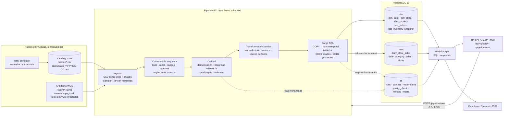
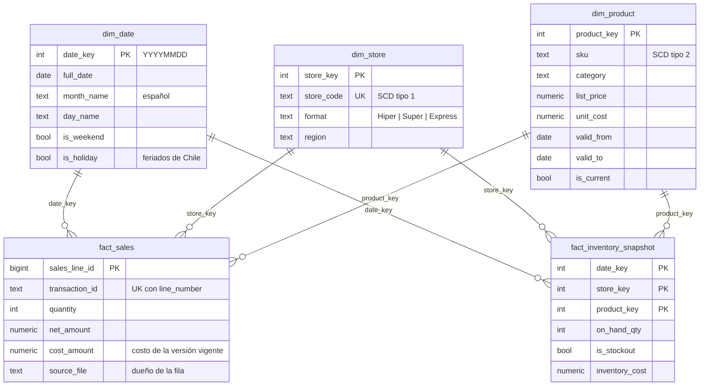

# Arquitectura

## Vista general



## Flujo de un lote

Un **lote** es la unidad atómica de carga: un archivo CSV o un día de snapshot de inventario.

```mermaid
sequenceDiagram
    participant R as Runner
    participant S as Fuente
    participant Q as Calidad
    participant DB as PostgreSQL
    R->>DB: pg_try_advisory_lock (una ejecución a la vez)
    R->>DB: INSERT etl.pipeline_run
    loop por cada archivo nuevo/cambiado o día > watermark
        R->>DB: INSERT etl.batch (running)
        R->>S: leer CSV / GET paginado (reintentos + backoff)
        R->>Q: limpiar → validar contrato → deduplicar → RI → quality gate
        alt lote válido
            R->>DB: BEGIN; COPY → MERGE en dw; batch=loaded; registro/watermark; COMMIT
        else contrato roto o >5 % filas malas
            R->>DB: batch=rejected + quality_check + rejected_record
        else fuente caída
            R->>DB: batch=failed; watermark NO avanza; se detiene esa fuente
        end
    end
    R->>DB: refrescar marts solo para las fechas tocadas
    R->>DB: UPDATE pipeline_run (success | partial | failed, métricas JSON)
```

## Modelo dimensional



Granos: `fact_sales` = una línea de ticket; `fact_inventory_snapshot` = un producto en una
tienda al cierre de un día (snapshot periódico).

## Decisiones de diseño (ADR)

**ADR-1 · pandas para transformar, SQL para unir y fusionar.** pandas limpia, tipa y
deriva columnas por lote (miles de filas). Las búsquedas de claves sustitutas, el SCD2 y los
upserts se hacen en PostgreSQL con operaciones de conjunto (`COPY` a tabla temporal +
`INSERT … ON CONFLICT`), que son más rápidas, atómicas y verificables que iterar en Python.

**ADR-2 · Contratos propios en lugar de Pandera/Great Expectations.** Un módulo de ~200
líneas (`quality/contracts.py`) cubre tipos, nulos, rangos, patrones, valores permitidos y
reglas entre campos, y registra la *primera* regla rota de cada fila. Evita una dependencia
pesada y es fácil de explicar; migrar a Pandera sería directo porque los contratos son
declarativos.

**ADR-3 · Validación en dos niveles.** Problemas estructurales (columna faltante, CSV
ilegible) rechazan el lote completo; problemas por fila ponen en cuarentena solo esas
filas (`etl.rejected_record`, con los valores originales en JSONB). El *quality gate*
rechaza el lote si más del 5 % (`QUALITY_MAX_REJECT_RATIO`) de las filas son inválidas: un
archivo así suele indicar un problema de la fuente, no ruido.

**ADR-4 · Incrementalidad por tipo de fuente.**
- CSV: registro `(archivo, sha256)` en `etl.processed_file`. Un archivo sin cambios se
  omite; uno re-entregado con otro contenido **reemplaza** las filas que le pertenecen
  (`fact_sales.source_file`), incluso líneas eliminadas.
- API: *watermark* por fecha en `etl.watermark`; se avanza día a día dentro de la misma
  transacción que carga ese día. Si la API cae, el watermark queda en el último día
  confirmado y la siguiente ejecución retoma desde ahí.
- Marts: se recalculan solo las fechas tocadas por la ejecución.

**ADR-5 · Idempotencia.** Toda carga es un upsert por clave natural y cada lote es una
transacción, así que reintentar o usar `--full-refresh` nunca duplica datos (probado).

**ADR-6 · SCD2 en productos, SCD1 en tiendas.** Precio, costo y clasificación cambian y el
margen histórico debe usar el costo vigente en la fecha de venta. Una SKU nueva abre su
primera versión en `1900-01-01` para cubrir ventas cargadas antes que el maestro; un
cambio sin `updated_at` posterior se trata como corrección (sobrescritura).

**ADR-7 · Una ejecución a la vez.** `pg_try_advisory_lock` a nivel de sesión: si el proceso
muere, PostgreSQL libera el lock solo. La API además evita dos disparos simultáneos en el
mismo proceso (HTTP 409).

**ADR-8 · Datos sintéticos deterministas.** Cada número aleatorio depende de
`(semilla, propósito, día, tienda)`, nunca del largo del horizonte; simular 61 días
reproduce los primeros 60 byte a byte. Por eso basta subir `SIM_DAYS` para demostrar la
carga incremental, y los totales son idénticos en Windows y en Linux (Docker).

**ADR-9 · Un módulo de KPI compartido.** `analytics/kpis.py` contiene el SQL de todas las
métricas; la API y el dashboard lo importan, así nunca muestran cifras distintas.

**ADR-10 · Códigos de salida para orquestadores.** `retail run` devuelve 0 (éxito),
2 (parcial: lotes rechazados o fuente caída), 3 (otra ejecución en curso) o 1 (fallo). El
programador incluido (`retail schedule`) es para la demo; en producción se usaría cron,
Airflow o un job programado de Kubernetes.

## Trabajo futuro

- Particionar `fact_sales` por mes cuando supere decenas de millones de filas.
- Reemplazar el *scheduler* de demo por Airflow/Dagster y publicar métricas (Prometheus).
- Reprocesar registros en cuarentena desde la API tras corregirlos.
- dbt para documentar y testear los marts SQL.
